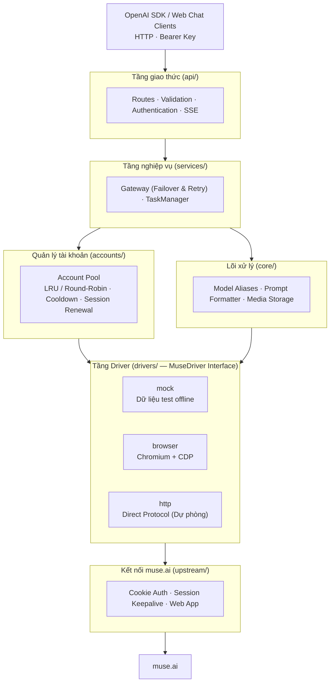

<h1 align="center">muse2api</h1>

<p align="center">
  <b>Tiếng Việt</b> | <a href="README.en.md">English</a> | <a href="README.zh-CN.md">中文</a>
</p>

<p align="center">
  Cổng API bất đồng bộ (Async Gateway) biến ứng dụng web <a href="https://muse.ai">muse.ai</a> thành <b>chuẩn API OpenAI</b>
</p>

<p align="center">
  
  
  
  
  
</p>

---

## Mục lục

- [Tổng quan](#tổng-quan)
- [Tính năng nổi bật](#tính-năng-nổi-bật)
- [Kiến trúc hệ thống](#kiến-trúc-hệ-thống)
- [Cấu trúc thư mục](#cấu-trúc-thư-mục)
- [Hướng dẫn cài đặt & Khởi chạy](#hướng-dẫn-cài-đặt--khởi-chạy)
  - [Chạy nhanh trên Windows (Laragon)](#chạy-nhanh-trên-windows-laragon)
  - [Chạy thủ công với môi trường ảo Python](#chạy-thủ-công-với-môi-trường-ảo-python)
  - [Chạy qua Docker](#chạy-qua-docker)
- [Cấu hình tài khoản muse.ai](#cấu-hình-tài-khoản-museai)
- [Ví dụ gọi API](#ví-dụ-gọi-api)
  - [Chat hội thoại (Hỗ trợ Streaming SSE)](#chat-hội-thoại-hỗ-trợ-streaming-sse)
  - [OpenAI Python SDK](#openai-python-sdk)
  - [Tạo ảnh từ văn bản (Text to Image)](#tạo-ảnh-từ-văn-bản-text-to-image)
  - [Tạo ảnh tách nền trong suốt (Transparent Background)](#tạo-ảnh-tách-nền-trong-suốt-transparent-background)
  - [Tạo ảnh từ ảnh tham chiếu (Image to Image / Edits)](#tạo-ảnh-từ-ảnh-tham-chiếu-image-to-image--edits)
  - [Tạo video bất đồng bộ (Text to Video)](#tạo-video-bất-đồng-bộ-text-to-video)
- [Danh sách Endpoints](#danh-sách-endpoints)
- [Web Dashboard & Quản lý API Key](#web-dashboard--quản-lý-api-key)
- [Cấu hình biến môi trường (.env)](#cấu-hình-biến-môi-trường-env)
- [Tuyên bố miễn trừ trách nhiệm](#tuyên-bố-miễn-trừ-trách-nhiệm)
- [Giấy phép](#giấy-phép)

---

## Tổng quan

**muse2api** là cổng trung gian chuyển đổi các tính năng chat, vẽ ảnh (text-to-image) và tạo video (text-to-video) của [muse.ai](https://muse.ai) thành các endpoint chuẩn theo đặc tả của OpenAI (`/v1/chat/completions`, `/v1/images/generations`, `/v1/videos`,...). 

Nhờ đó, bạn có thể tích hợp trực tiếp muse.ai vào mọi ứng dụng, công cụ hoặc SDK OpenAI hiện có như:
- Thư viện lập trình: `openai-python`, `openai-node`, LangChain, LlamaIndex,...
- Ứng dụng chat giao diện người dùng: ChatGPT-Next-Web, LobeChat, Cherry Studio, BetterChatGPT,...
- Chỉ cần cấu hình:
  - `Base URL`: `http://127.0.0.1:18610/v1` (hoặc domain nội bộ `http://muse2api.test/v1`)
  - `API Key`: Khóa API do hệ thống cấp.

---

## Tính năng nổi bật

- **Chuẩn OpenAI 100%**: Hỗ trợ đầy đủ chat streaming (SSE), non-streaming, đa lượt hội thoại (multi-turn), system prompt, bí danh mô hình (model aliases như `gpt-4o`, `dall-e-3`).
- **Driver linh hoạt (Pluggable Drivers)**:
  - `browser`: Điều khiển trình duyệt Chromium tự động qua Chrome DevTools Protocol (CDP) không cần cài đặt WebDriver cồng kềnh.
  - `mock`: Dữ liệu giả lập phục vụ viết unit test và phát triển giao diện ngoại tuyến mà không cần tài khoản thật.
- **Account Pool (Bể tài khoản) thông minh**:
  - Hỗ trợ chạy đồng thời nhiều tài khoản muse.ai.
  - Chiến lược điều phối: `lru` (ít dùng nhất), `round_robin` (xoay vòng), `affinity` (gắn liền phiên).
  - Tự động phát hiện phiên hết hạn (session expired), cooldown tài khoản gặp lỗi và tự động chuyển đổi dự phòng (failover) sang tài khoản khác mà không làm gián đoạn người dùng.
- **Tách nền ảnh tự động (Matting / Transparent Background)**: Hỗ trợ tạo ảnh với nền trong suốt (RGBA PNG) nhờ mô hình BiRefNet tích hợp sẵn khi truyền tham số `"background": "transparent"`.
- **Tác vụ nền bất đồng bộ (Async Tasks)**: Tạo video và sinh ảnh phức tạp chạy nền, tránh lỗi timeout (HTTP 524 Cloudflare / Proxy).
- **Web Dashboard trực quan**: Giao diện quản lý tài khoản, tạo/thu hồi API Key, xem biểu đồ request, độ trễ và nhật ký lỗi theo thời gian thực tại `/dashboard`.
- **Hoàn toàn bất đồng bộ (Asyncio + FastAPI)**: Tối ưu hiệu năng cao, không nghẽn thread.

---

## Kiến trúc hệ thống



---

## Cấu trúc thư mục

```
muse2api/
├── src/muse2api/
│   ├── app.py                 # Khởi tạo FastAPI App & vòng đời ứng dụng
│   ├── config.py              # Đọc cấu hình từ biến môi trường (.env)
│   ├── errors.py              # Xử lý và chuyển đổi mã lỗi sang chuẩn OpenAI
│   ├── api/
│   │   ├── deps.py            # Middleware xác thực & Dependency Injection
│   │   ├── schemas.py         # Pydantic schemas cho OpenAI Requests/Responses
│   │   └── routes/            # Các endpoint: chat, images, videos, admin, dashboard...
│   ├── services/
│   │   ├── gateway.py         # Điều phối driver, chuyển tài khoản dự phòng khi lỗi
│   │   ├── tasks.py           # Quản lý tác vụ tạo video/ảnh nền dài hạn
│   │   └── container.py       # Khởi tạo và liên kết các service
│   ├── accounts/              # Mô hình tài khoản, JSON store, Account Pool
│   ├── core/                  # Quản lý model aliases, xử lý prompt, lưu trữ media
│   ├── drivers/
│   │   ├── base.py            # Interface trừu tượng MuseDriver
│   │   ├── mock.py            # Driver dữ liệu mẫu offline
│   │   └── browser/           # Driver Chromium CDP điều khiển trang muse.ai
│   └── upstream/muse.py       # Các hằng số URL và hàm tương tác muse.ai
├── data/                      # Lưu trữ cục bộ: accounts.json, keys.json, media/
├── tests/                     # Bộ kiểm thử tự động (80+ unit tests)
├── run.bat                    # Script khởi chạy nhanh 1-click trên Windows
├── index.php                  # Proxy trung gian cho Laragon (hỗ trợ *.test)
├── Dockerfile                 # Đóng gói container Docker
├── docker-compose.yml         # Triển khai Docker Compose
└── .env.example               # Mẫu file cấu hình
```

---

## Hướng dẫn cài đặt & Khởi chạy

### Chạy nhanh trên Windows (Laragon)

Nếu bạn sử dụng Laragon trên Windows:
1. Đặt thư mục dự án tại `C:\laragon\www\muse2api`.
2. Đảm bảo máy đã cài đặt Python 3.10+ và Google Chrome.
3. Cài đặt các thư viện phụ thuộc:
   ```cmd
   cd C:\laragon\www\muse2api
   pip install -e .
   ```
4. Click đúp vào file **`run.bat`** để khởi chạy server backend.
5. Truy cập giao diện quản trị tại:
   - **Trực tiếp:** [http://127.0.0.1:18610/dashboard](http://127.0.0.1:18610/dashboard)
   - **Qua Laragon Proxy:** [http://muse2api.test/dashboard](http://muse2api.test/dashboard)

### Chạy thủ công với môi trường ảo Python

```bash
# 1. Clone repository
git clone https://github.com/caykhe36/muse2api.git
cd muse2api

# 2. Tạo và kích hoạt môi trường ảo
python -m venv .venv
# Trên Linux/macOS:
source .venv/bin/activate
# Trên Windows:
.venv\Scripts\activate

# 3. Cài đặt thư viện
pip install -e '.[dev]'

# 4. Sao chép cấu hình mẫu
cp .env.example .env

# 5. Khởi chạy
python -m muse2api
```
Server mặc định sẽ lắng nghe tại `http://127.0.0.1:18610`. Nếu chưa đặt khóa bí mật, API key đầu tiên sẽ được tự động tạo và lưu tại file `data/api_key`.

### Chạy qua Docker

```bash
cp .env.example .env
docker compose up -d --build
```

---

## Cấu hình tài khoản muse.ai

Để sử dụng tài khoản thật (`MUSE2API_DRIVER=browser`):

1. Đảm bảo máy chủ có cài đặt Google Chrome hoặc Chromium.
2. Đăng nhập vào trang [muse.ai](https://muse.ai) trên trình duyệt của bạn.
3. Xuất Cookie của trang web (sử dụng tiện ích như *EditThisCookie* hoặc *Cookie-Editor*). Các cookie quan trọng gồm có:
   - `hatch_sess`
   - `hatch_gw`
   - `hatch_vml`
   - `hatch_native_auth_device`
4. Mở trang Web Dashboard tại `http://127.0.0.1:18610/dashboard` và dán Cookie vào mục **Add Account** (hoặc gọi qua Admin API).

---

## Ví dụ gọi API

Mọi endpoint `/v1/*` đều yêu cầu header `Authorization: Bearer <API_KEY>`.

### Chat hội thoại (Hỗ trợ Streaming SSE)

```bash
curl http://127.0.0.1:18610/v1/chat/completions \
  -H "Authorization: Bearer $KEY" \
  -H "Content-Type: application/json" \
  -d '{
    "model": "gpt-4o",
    "messages": [
      {"role": "user", "content": "Xin chào! Bạn có thể giới thiệu về bản thân không?"}
    ],
    "stream": true
  }'
```

### OpenAI Python SDK

```python
from openai import OpenAI

client = OpenAI(
    base_url="http://127.0.0.1:18610/v1",
    api_key="your-api-key"
)

response = client.chat.completions.create(
    model="muse-chat",
    messages=[
        {"role": "user", "content": "Viết một đoạn văn ngắn về vẻ đẹp của Hà Nội vào mùa thu."}
    ],
    stream=False
)

print(response.choices[0].message.content)
```

### Tạo ảnh từ văn bản (Text to Image)

```bash
curl http://127.0.0.1:18610/v1/images/generations \
  -H "Authorization: Bearer $KEY" \
  -H "Content-Type: application/json" \
  -d '{
    "prompt": "Một góc phố cổ Hà Nội dưới cơn mưa chiều, phong cách điện ảnh chân thực",
    "size": "16:9",
    "response_format": "url"
  }'
```

### Tạo ảnh tách nền trong suốt (Transparent Background)

Yêu cầu cài đặt thêm gói `pip install -e '.[matting]'`:

```bash
curl http://127.0.0.1:18610/v1/images/generations \
  -H "Authorization: Bearer $KEY" \
  -H "Content-Type: application/json" \
  -d '{
    "prompt": "Một chú mèo con lông vàng ngồi dễ thương",
    "background": "transparent"
  }'
```

### Tạo ảnh từ ảnh tham chiếu (Image to Image / Edits)

Hỗ trợ truyền tối đa 4 ảnh tham chiếu (`data URL`, link `http(s)` hoặc `base64`):

```bash
curl http://127.0.0.1:18610/v1/images/generations \
  -H "Authorization: Bearer $KEY" \
  -H "Content-Type: application/json" \
  -d '{
    "prompt": "Người mẫu đang mặc chiếc áo này, bối cảnh studio chuyên nghiệp",
    "image": "data:image/jpeg;base64,..."
  }'
```

### Tạo video bất đồng bộ (Text to Video)

Tạo tác vụ sinh video:
```bash
curl http://127.0.0.1:18610/v1/videos \
  -H "Authorization: Bearer $KEY" \
  -H "Content-Type: application/json" \
  -d '{
    "prompt": "Lá phong rơi nhẹ nhàng trong làn gió thu",
    "duration": 5,
    "size": "16:9"
  }'
# Trả về: {"id": "task_123456", "status": "queued", ...}
```

Kiểm tra tiến độ tác vụ:
```bash
curl http://127.0.0.1:18610/v1/videos/task_123456 \
  -H "Authorization: Bearer $KEY"
```

---

## Danh sách Endpoints

| Phương thức | Đường dẫn | Mô tả chức năng |
|---|---|---|
| `GET` | `/healthz` · `/readyz` | Kiểm tra tình trạng hoạt động của service & driver |
| `GET` | `/v1/models` | Danh sách các model hỗ trợ (`gpt-4o`, `dall-e-3`, `muse-chat`,...) |
| `POST` | `/v1/chat/completions` | Hội thoại thông minh (hỗ trợ cả streaming và non-streaming) |
| `POST` | `/v1/images/generations` | Tạo ảnh từ văn bản hoặc từ ảnh tham chiếu |
| `POST` | `/v1/images/edits` | Chỉnh sửa / biến đổi ảnh chuẩn multipart OpenAI |
| `POST` | `/v1/videos` | Khởi tạo tác vụ tạo video bất đồng bộ |
| `GET` | `/v1/videos/{id}` | Lấy kết quả hoặc kiểm tra tiến độ video |
| `GET` | `/v1/media/{filename}` | Tải về các tệp hình ảnh / video đã được tạo |
| `GET/POST` | `/admin/accounts` | Quản lý thêm / sửa / xóa tài khoản muse.ai |
| `POST` | `/admin/accounts/import`| Nhập hàng loạt tài khoản bằng JSON Cookie |
| `POST` | `/admin/accounts/{id}/renew` | Làm mới session tài khoản |
| `GET/POST/DELETE`| `/admin/keys` | Quản lý và cấp phát API Key cho client |
| `GET` | `/admin/requests` | Xem nhật ký request chi tiết (IP, độ trễ, tài khoản...) |
| `GET` | `/dashboard` | Giao diện Dashboard quản trị web trực quan |

---

## Web Dashboard & Quản lý API Key

Truy cập `http://127.0.0.1:18610/dashboard` để sử dụng Dashboard:
- Nhập **Admin Key** để đăng nhập (lưu trong `localStorage` của trình duyệt).
- **Thống kê:** Xem lưu lượng request, tỷ lệ lỗi, độ trễ trung bình theo các mốc thời gian 1h / 24h / 7 ngày.
- **Quản lý tài khoản:** Xem danh sách tài khoản, trạng thái quota, bật/tắt hoặc gia hạn session.
- **Quản lý API Key:** Tạo mới các khóa API định dạng `m2a-...`, phân quyền hoặc thu hồi khi cần thiết. Hệ thống chỉ lưu chuỗi băm SHA-256 an toàn.
- **Nhật ký:** Theo dõi trực tiếp từng request kèm thông tin client IP, model và account đã xử lý.

---

## Cấu hình biến môi trường (.env)

| Biến | Mặc định | Mô tả |
|---|---|---|
| `MUSE2API_DRIVER` | `browser` | Loại driver: `browser` (thật), `mock` (test) |
| `MUSE2API_HOST` | `127.0.0.1` | Địa chỉ IP lắng nghe |
| `MUSE2API_PORT` | `18610` | Cổng dịch vụ |
| `MUSE2API_API_KEY` | *(Tự tạo)* | Khóa API dùng cho các endpoint `/v1/*` |
| `MUSE2API_ADMIN_KEY`| *(Như API Key)*| Khóa quản trị truy cập `/dashboard` và `/admin/*` |
| `MUSE2API_POOL_STRATEGY` | `lru` | Chiến lược chọn tài khoản: `lru` / `round_robin` / `affinity` |
| `MUSE2API_MAX_FAILOVER` | `2` | Số lần thử lại tối đa sang tài khoản khác khi gặp lỗi |
| `MUSE2API_ACCOUNT_MAX_CONCURRENCY` | `2` | Số lượng request đồng thời trên 1 tài khoản |
| `MUSE2API_MEDIA_RETENTION_DAYS` | `14` | Số ngày lưu trữ media đã tạo trước khi tự động dọn dẹp |
| `MUSE2API_REQUEST_LOG_RETENTION_DAYS` | `14` | Số ngày lưu trữ nhật ký truy vấn trong SQLite |

---

## Tuyên bố miễn trừ trách nhiệm

Dự án này được phát triển phục vụ mục đích học tập và nghiên cứu kỹ thuật. Người sử dụng có trách nhiệm tuân thủ điều khoản dịch vụ của [muse.ai](https://muse.ai) và các quy định pháp luật hiện hành. Tuyệt đối không chia sẻ hoặc công khai cookie tài khoản cá nhân.

---

## Giấy phép

Mã nguồn được phân phối theo giấy phép [MIT License](LICENSE).
